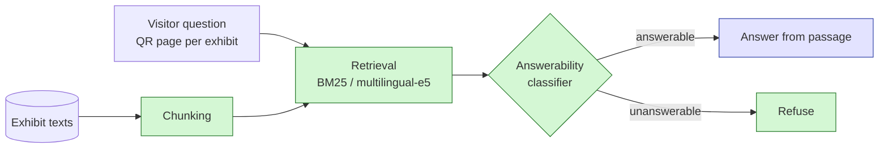

# Talking Exhibits

**Detecting unanswerable visitor questions in exhibit-grounded question answering for Bosnian and English**

Course project for **IT 3004 Introduction to Natural Language Processing**, International Burch University, 2026/2027.
Topic **#1 Talking exhibits**.

## Team

| Member | GitHub | Email | Main responsibility |
| --- | --- | --- | --- |
| Mirza Čakal | @MirzaCakal-student | mirza.cakal@stu.ibu.edu.ba | Answerability classifier, retrieval pipeline |
| Tarik Hadrović | @Tarik111345 | tarik.hadrovic@stu.ibu.edu.ba | Exhibit texts, question set, test set |
| Kerim Hodžić | @kerim279 | kerim.hodzic@stu.ibu.edu.ba | Evaluation, LLM baseline, error analysis, demo |

## Problem

A visitor scans a QR code beside an exhibit (IBU campus, projects and history) and asks a question.
The system must answer **only from that exhibit's text** and **refuse** when the text does not contain the answer.

**Research question:** How reliably can the system detect questions the exhibit text cannot answer and refuse instead of guessing?

## Planned pipeline



Green = built by the team, blue = external model. Details:

| Component | Own / external |
| --- | --- |
| Chunking, BM25 baseline, retrieval pipeline | Own |
| Answerability classifier (fine-tuned XLM-RoBERTa-base) | Own (fine-tuning), external base weights |
| multilingual-e5 embeddings | External |
| LLM baseline and answer wording (open model via Ollama) | External |
| Whisper speech-to-text (optional) | External |
| Question set, test set, evaluation | Own |

## Repository structure

```
talking-exhibits/
├── data/
│   ├── exhibits/      # exhibit texts (or build instructions if redistribution is not allowed)
│   ├── questions/     # own labelled question set
│   └── processed/     # generated files (not in git)
├── src/talking_exhibits/  # pipeline code
├── scripts/           # run, train and evaluate
├── results/           # saved metrics and figures
├── docs/AI_LOG.md     # every use of AI tools
├── CONTRIBUTIONS.md   # who did what
└── pyproject.toml
```

## Setup

Requires Python 3.12 and [uv](https://docs.astral.sh/uv/).

```bash
uv sync
```

Run instructions will be added with the first working baseline (Milestone 3). All experiments use fixed random seeds.

## Status

- [x] M1: team and topic
- [x] M2: proposal and repository
- [ ] M3: data, baseline, first results
- [ ] Final submission
