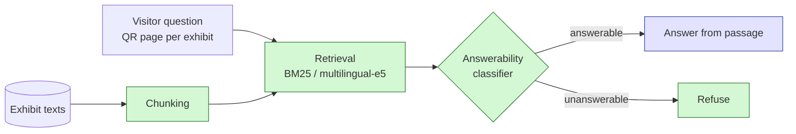

# Talking Exhibits

**Detecting unanswerable visitor questions in exhibit-grounded question answering for Bosnian and English**

Course project for **IT 3004 Introduction to Natural Language Processing**, International Burch University, 2026/2027.
Topic **#1 Talking exhibits**.

## Team

| Member | GitHub | Email | Main responsibility |
| --- | --- | --- | --- |
| Mirza Čakal | @MirzaCakal-student | mirza.cakal@stu.ibu.edu.ba | Answerability classifier, retrieval pipeline |
| Tarik Hadrović | @Tarik111345 | tarik.hadrovic@stu.ibu.edu.ba | Exhibit texts, question set, test set |
| Kerim Hodžić | @kerim279 | kerim.hodzic@stu.ibu.edu.ba | Evaluation, LLM baseline, error analysis, demo |

## Problem

A visitor scans a QR code beside an exhibit (IBU campus, projects and history) and asks a question.
The system must answer **only from that exhibit's text** and **refuse** when the text does not contain the answer.

**Research question:** How reliably can the system detect questions the exhibit text cannot answer and refuse instead of guessing?

## Planned pipeline



Green = built by the team, blue = external model. Details:

| Component | Own / external |
| --- | --- |
| Chunking, BM25 baseline, retrieval pipeline | Own |
| Answerability classifier (fine-tuned XLM-RoBERTa-base) | Own (fine-tuning), external base weights |
| multilingual-e5 embeddings (`intfloat/multilingual-e5-base`, MIT license) | External model, own retrieval code |
| LLM baseline and answer wording (open model via Ollama) | External |
| Whisper speech-to-text (optional) | External |
| Question set, test set, evaluation | Own |

## Repository structure

```
talking-exhibits/
├── data/
│   ├── exhibits/      # exhibit texts (or build instructions if redistribution is not allowed)
│   ├── questions/     # own labelled question set
│   └── processed/     # generated files (not in git)
├── src/talking_exhibits/
│   ├── data.py        # 1. load and check exhibits and questions
│   ├── preprocess.py  # 2. normalization, sentence splitting, chunking
│   └── retrieval.py   # 3. BM25 (own implementation) and multilingual-e5 retrieval
├── scripts/
│   └── run_baselines.py  # baselines B0, B1 (BM25 + threshold), B1b (e5 + threshold)
├── tests/             # pytest tests (+ fictional fixtures in tests/fixtures/)
├── results/           # saved metrics and figures
├── docs/AI_LOG.md     # every use of AI tools
├── CONTRIBUTIONS.md   # who did what
├── pyproject.toml     # dependencies
└── uv.lock            # exact package versions
```

## Setup

Requires Python 3.12 and [uv](https://docs.astral.sh/uv/).

```bash
uv sync
uv run pytest
```

Always use `uv run`, so every command uses the package versions from `uv.lock`.

## How to run

**Baselines on the validation split** (needs `data/exhibits/` and `data/processed/val.csv`):

```bash
uv run python scripts/run_baselines.py
```

This cuts the exhibits into passages, retrieves the top 3 passages of the asked exhibit for
every question, and compares three systems: **B0** always answers, **B1** refuses when the best
BM25 score is below a threshold, **B1b** does the same with multilingual-e5 cosine similarity.
The threshold is chosen on the validation questions (highest F1 of the class *refuse*).
Output: a table in the terminal, `results/val_baselines.json` and
`results/val_predictions_<system>.csv`. The test split is never read by this script.

The first run downloads the pretrained model `intfloat/multilingual-e5-base` (about 1 GB);
add `--no-e5` to skip it. Passage embeddings are cached in `data/processed/`.

**Smoke test without the real dataset** (fictional exhibits in `tests/fixtures/`):

```bash
uv run python scripts/run_baselines.py --exhibits tests/fixtures/exhibits --questions tests/fixtures/questions_val.csv --out results/fixture_demo --chunk-size 60 --overlap 15
```

Numbers from the fixtures only show that the code runs; they are not project results.

**Reproducibility:** the random seed is fixed to `3004` in every script, and the baselines are
deterministic (same input, same numbers).

## Status

- [x] M1: team and topic
- [x] M2: proposal and repository
- [ ] M3: data, baseline, first results
- [ ] Final submission
